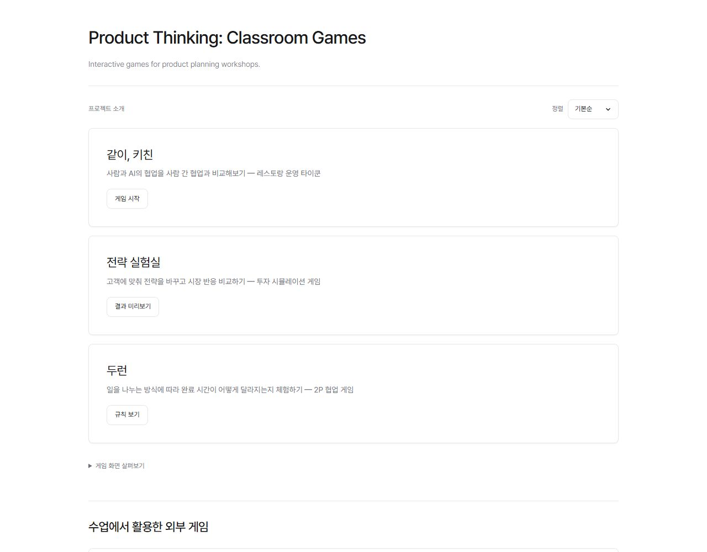

# Product Thinking: Classroom Games

Interactive games for product planning workshops.

A collection of games used and refined in classroom workshops. Explore how teams share work, where waiting happens, and how customer choices shape a product strategy.

[Open the game collection](https://nana-park.github.io/product-thinking-classroom-games/)

| Game | What to explore | Available here |
|---|---|---|
| [같이, 키친 — Together, Kitchen](games/together-kitchen/README.md) | Teamwork, roles, and bottlenecks | A playable 60-second static game for 1–2 people |
| [전략 실험실 — Strategy Lab](games/strategy-lab/README.md) | Customer value and competition | External read-only previews with fictional results |
| [두런 — Duorun](games/duorun/README.md) | Work splitting and waiting | A rules preview, a rule engine, and tests |

## Run locally

Install Node.js, then run:

    node tools/serve.cjs

Open http://127.0.0.1:4381. No packages, account, or API key are needed. The hub and Together, Kitchen are static files. Duorun's actual two-player game needs a server and shared storage; this collection does not run that service.

To test the Duorun rule engine:

    node --test games/duorun/test/game.test.mjs

## About the games

**Together, Kitchen** compares solo play, two people sharing a keyboard, and a person working with a rule-based AI partner. It does not use generative AI. Practice and play order affect the results, so scores are not evidence of a causal productivity effect. The included files are recovered assets from the current public game, not its original repository history. The source notes and SHA256 manifest are included in its folder.

**Strategy Lab** explores a fictional meal-subscription market with four customer groups over five rounds. Only a fictional preview image and read-only preview links are included. Its backend and real classroom data are not included.

**Duorun** introduces two ways to divide a typing task between two people. The public copy uses clearly synthetic Hangul examples, unrelated to real participants. Its original private service remains private.

## Scope and verification

Student information, classroom records, credentials, databases, and deployment settings are excluded. Third-party User Inyerface code is not included. No unverified learning outcomes, productivity gains, employment claims, or teaching credentials are asserted.

The collection was checked on desktop and mobile. The included Duorun tests pass. See [local verification notes](docs/VERIFICATION.md). No open-source license has been added; public access alone does not grant a reuse license.

## External games used in class

[User Inyerface](https://userinyerface.com/) — Experience confusing interface patterns and discuss what gets in a user’s way. This is an external game, not an original project in this collection. Only the original link is provided; no external game code or screen is copied.
