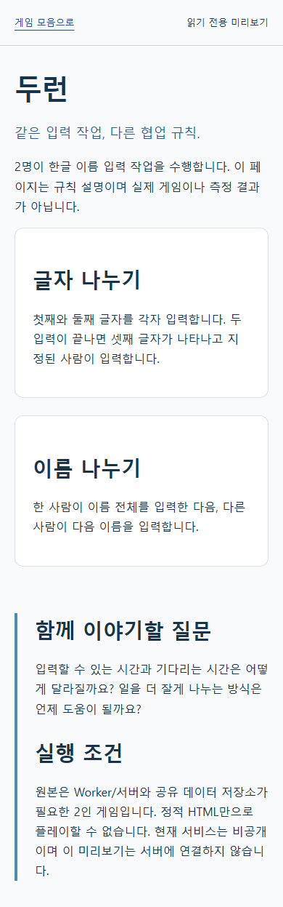

# 두런

상태: 읽기 전용 미리보기

## 캡처

[읽기 전용 규칙 미리보기](preview.html). 원본 게임 캡처가 아닌 설명 자료입니다.

## 학습 목표
작업 분담 규칙에 따른 입력 가능 시간과 대기 시간을 관찰하고 토론합니다. 이는 교육 효과 검증 결과가 아닙니다.

## 인원
2명

## 실행 방법
preview.html을 브라우저에서 열면 규칙을 읽을 수 있습니다. 게임 실행은 지원하지 않습니다. 규칙 엔진 검증: 저장소 루트에서 `node --test games/duorun/test/game.test.mjs`. 실제 게임에는 별도 서버와 공유 저장소가 필요합니다.

## 공개 범위
규칙 엔진과 합성 입력 기반 테스트만 후보로 추렸습니다. 원본 UI, 서버, 배포 설정, 데이터베이스, 참가 기록은 포함하지 않았습니다.

## 가상 예제 이름
공개 사본은 가나다·라마바 등의 합성 한글 문자열을 사용합니다. 실제 학생이나 참가자의 이름이 아닙니다. 원본 파일은 수정하지 않았습니다.
