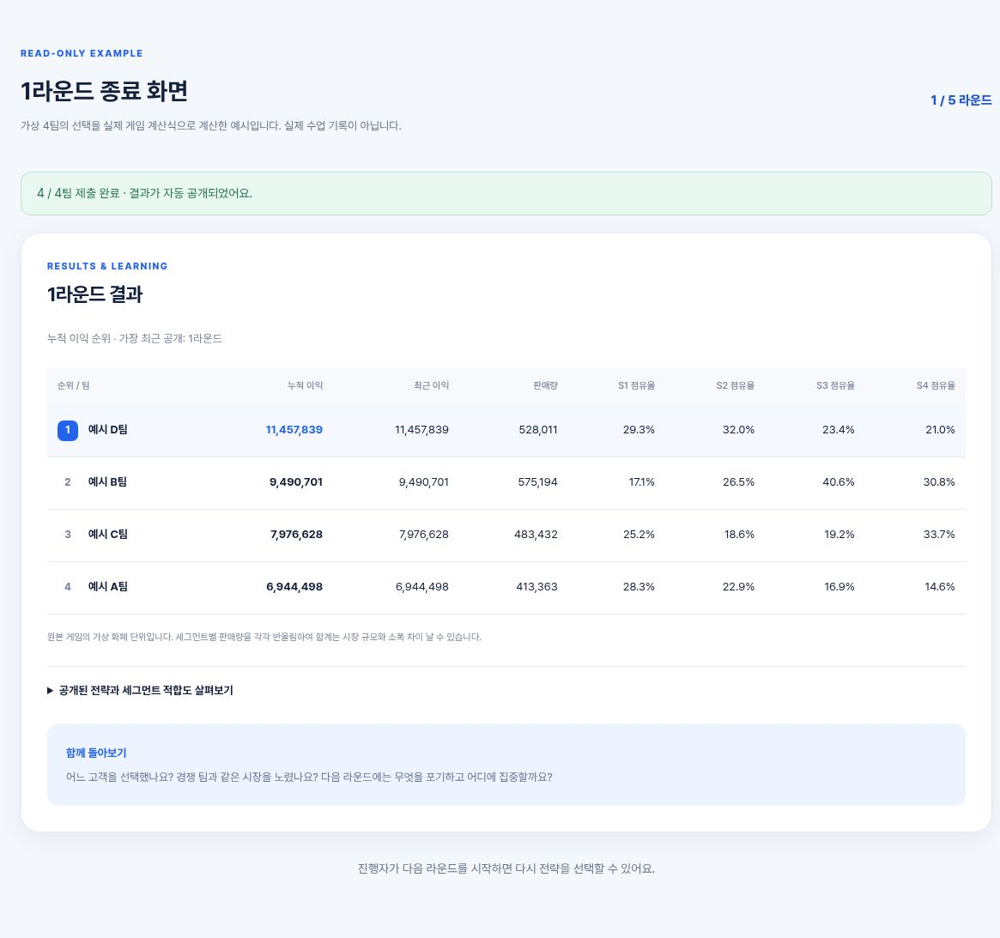

# 전략 실험실

## 학습 목표
가상 식사 구독 시장에서 네 고객군의 가치와 경쟁 선택을 비교하고 다섯 라운드의 점유율·이익을 토론합니다.

## 인원
팀 단위 게임입니다. 정확한 권장 인원은 확인이 필요합니다. 미리보기는 혼자 읽을 수 있습니다.

## 실행 방법
[가상 결과](https://customer-value-classroom.nana-the-variation.chatgpt.site/preview/results) · [가상 제출 화면](https://customer-value-classroom.nana-the-variation.chatgpt.site/preview/submitted)

백엔드 소스는 확보하지 않았습니다. 외부 읽기 전용 미리보기만 연결하며 실제 방, 전략, 수업 데이터는 복사하지 않았습니다. 캡처는 가상 예시입니다.
