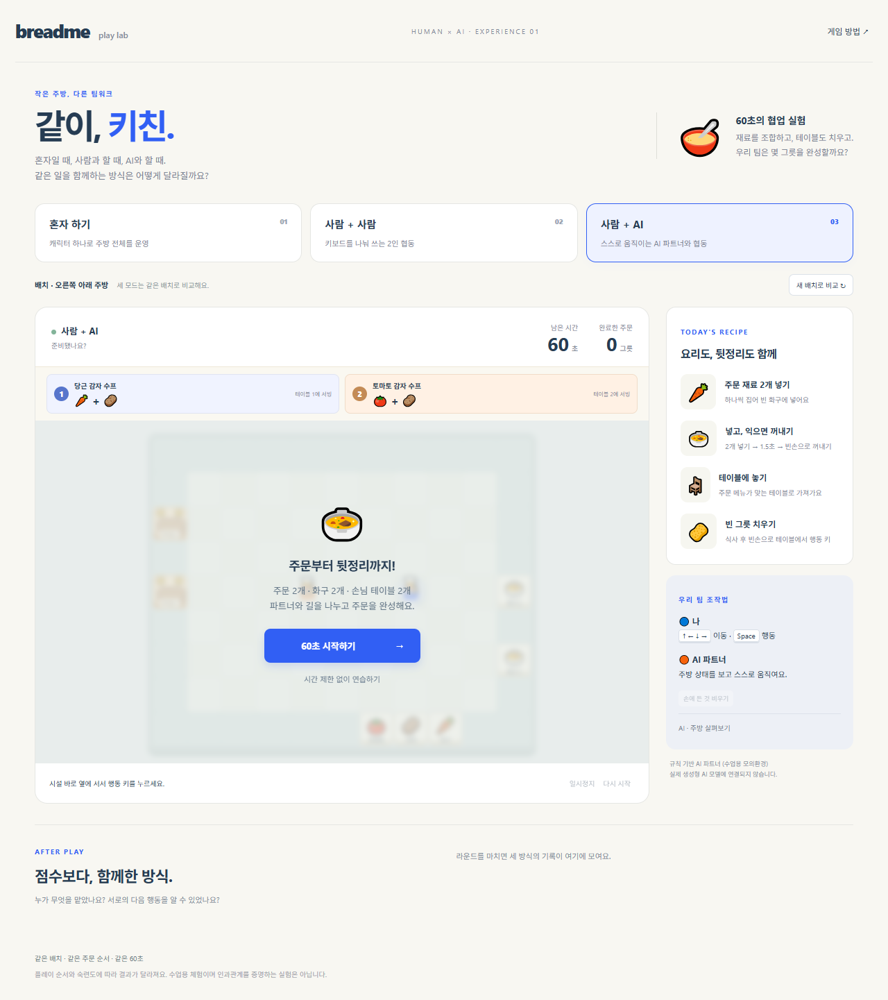

# 같이, 키친

## 학습 목표
같은 주방과 주문 조건에서 혼자, 사람-사람, 사람-규칙 기반 AI 협업의 역할 분담과 병목을 관찰합니다. 생성형 AI를 사용하지 않습니다. 플레이 순서와 숙련도 영향을 받으며 인과적 효과를 입증하는 실험은 아닙니다.

## 인원
혼자/AI 모드는 1명, 사람-사람 모드는 한 키보드를 공유하는 2명입니다. 모바일에서는 1인 조작을 확인합니다.

## 실행 방법
저장소 루트에서 node tools/serve.cjs 실행 후 http://127.0.0.1:4381/games/together-kitchen/ 로 접속합니다. 브라우저 ES 모듈을 사용하므로 file:// 직접 열기는 피합니다.

[원래 공개 게임](https://together-kitchen-lab.nana-the-variation.chatgpt.site)

## 출처
현재 공개된 HTML/CSS/JS를 회수한 실행 자산입니다. 원본 저장소의 개발 이력이 아닙니다. [회수 기록](SOURCE.md)과 [SHA256](recovery-manifest.json)을 보존했습니다.
